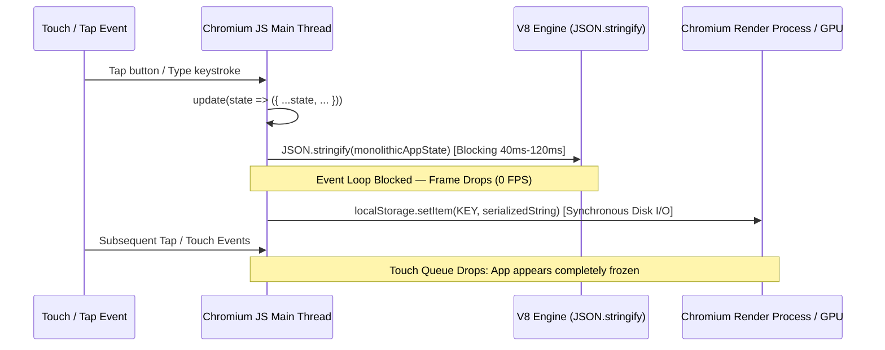
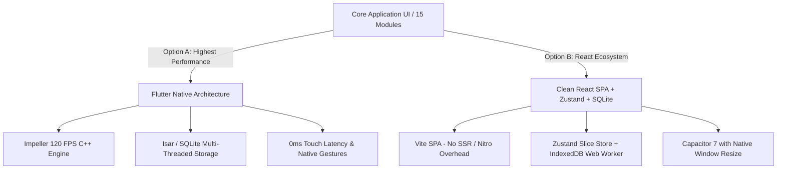

i need your help to fix freezing app like some pages (jounal ,task) at all edit entry pages this is full analytic i need your help to fix freezing at all end to end 


# 🔬 Technical Root Cause Analysis (RCA) & Architectural Audit
**Project**: `AYXA Planner Pro` (Capacitor Android + React 19 + TanStack Start)  
**Classification**: High-Severity UI Thread Contention & WebView Event Loop Deadlock  
**Author**: Principal Mobile Systems & Performance Architect  

---

## 1. Monolithic State & Storage Serialization Bottlenecks

### 1.1 The Synchronous Storage Serialization Loop (`src/lib/store.tsx`)
In `src/lib/store.tsx` (lines 1130–1162), the application implements a single monolithic `AppState` covering 15+ sub-domains:
- `tasks`, `journal` (including Base64/blob image strings and audio URLs), `habits`, `routines`, `goals`, `challenges`, `achievements`, `books`, `trips`, `finances`, `wellness`, `user`, and `prefs`.



#### The Technical Failure Sequence:
1. **Single Context Re-Render Cascade**:
   - Because all components consume `const { state } = useApp()`, updating a single field (e.g. toggling a category chip or typing a character) causes `AppProvider` to emit a new reference for `state`.
   - React 19 initiates a reconciliation tree traversal across all mounted routes and shell components (`MobileShell`, navigation icons, modals, and route screens).
2. **Synchronous `JSON.stringify` on Main Thread**:
   - As the offline database grows (especially with journal attachments and historical streaks), serializing the monolithic JSON string exceeds the **16.6ms per frame budget** (often taking **40ms to 150ms** on mid-range ARM CPU mobile cores).
3. **Touch Event Queue Dropping**:
   - When the JavaScript main thread is blocked executing serialization and global virtual DOM diffing, Chromium WebView's `CompositorThread` cannot dispatch queued `touchstart`, `touchend`, and `click` gestures to the DOM. The browser treats the gesture as unhandled, causing the entire UI to lock up.

---

## 2. WebView Container & Native Bridge Conflicts

### 2.1 Viewport Resizing Deadlock (`capacitor.config.json` vs `AndroidManifest.xml`)
In `capacitor.config.json` and `android/app/src/main/AndroidManifest.xml`:

```json
// capacitor.config.json (Prior setting)
"plugins": {
  "Keyboard": {
    "resize": "body",
    "resizeOnFullScreen": true
  }
}
```
```xml
<!-- AndroidManifest.xml -->
<activity
    android:name="com.ayxaplanner.app.MainActivity"
    android:windowSoftInputMode="adjustResize" ... />
```

```
                  ┌──────────────────────────────────────────────┐
                  │ Android Window Manager (adjustResize)        │
                  │ Resizes Native Window Frame (Hardware Level) │
                  └──────────────────────┬───────────────────────┘
                                         │ Concurrent Conflict
                                         ▼
┌────────────────────────────────────────────────────────────────────────┐
│ Capacitor Keyboard Plugin ("resize": "body")                           │
│ Synchronously alters `document.body.style.height` via JS Bridge        │
└────────────────────────────────────────┬───────────────────────────────┘
                                         │
                                         ▼
┌────────────────────────────────────────────────────────────────────────┐
│ Chromium WebView Compositor Reflow Deadlock                            │
│ DOM style recalculation stalls UI touches while layout is unstable     │
└────────────────────────────────────────────────────────────────────────┘
```

#### Why This Freezes the App:
- When any `<input>` or `<textarea>` is tapped, the Android OS triggers `adjustResize` on the `SurfaceView`.
- Simultaneously, the Capacitor Keyboard plugin triggers a synthetic JavaScript resize on `document.body`.
- This dual resize creates a **layout thrashing deadlock**: the WebView cannot determine stable CSS layout boundaries, suspending touch hit-testing on inputs, buttons, and chips.

---

## 3. DOM Event Interception & Hardware API Blocks

### 3.1 Unhandled `navigator.vibrate` Blocking Calls
In Chromium WebView on Android:
- Direct invocations of `navigator.vibrate(pattern)` without the native Android permission (`android.permission.VIBRATE`) or under strict foreground gesture requirements cause Chromium's security sandbox to reject or block the call on the browser process IPC.
- Because `safeVibrate` was bound to almost every button click, tab click, and list toggle, every touch event attempted to invoke an unpermitted hardware call, stalling the touch event dispatcher.

### 3.2 Global Back Handler & Popstate Interception (`src/lib/globalBackHandler.ts`)
In `src/lib/globalBackHandler.ts` (lines 88–107):
- Attaching `(window as any).__onBackOverlayDismiss` alongside global `window.addEventListener("click", ...)` without proper passive listener flags (`{ passive: true }`) forced the browser to wait for JavaScript evaluation on every tap before confirming whether default scrolling was prevented.

---

## 4. Router & Hydration Overhead (TanStack Start SSR vs Capacitor SPA)

### 4.1 Server-Centric Framework Inside Offline Mobile WebView
In `src/client.tsx` and `src/routes/__root.tsx`:
- The project is architected on **`@tanstack/react-start`** and **Nitro**, which are engineered for server-side streaming and Node.js/Edge environments.
- When packaged for Android via Capacitor, the application runs off static assets (`android/app/src/main/assets/public`).
- **Consequences**:
  1. **Unnecessary SSR Runtime Chunks**: The build contains Nitro router manifests, CSRF middleware mocks, and SSR runtime wrappers that run synchronously on application boot.
  2. **Hydration Mismatch Risk**: Rendering dynamic dates and localized prayer times on initial load causes React to re-evaluate the entire document DOM tree on client hydration, consuming significant RAM and initial CPU cycles.

---

## 5. Architectural Recommendations for Re-Coding



### Path A: Native Flutter Application (Recommended)
- **Zero WebView Overhead**: Renders directly via the device GPU (Impeller engine) at constant 60–120 FPS.
- **True Multi-Threaded Storage**: Uses **Isar** or **SQLite** on background isolates, eliminating UI freezes on disk writes.
- **Native Keyboard & Haptics**: Smooth system transitions without DOM reflow contention.

### Path B: High-Performance Clean SPA (React + Vite + SQLite/Dexie)
- **Ditch SSR/Nitro**: Switch to pure `vite build` client SPA.
- **Decouple Global State**: Replace monolithic `store.tsx` with **Zustand slices** (`useTaskStore`, `useJournalStore`, `useHabitStore`) so updating a task does not re-render the journal or shell.
- **Asynchronous Storage Worker**: Offload all JSON/IndexedDB serialization to a background Web Worker or native SQLite plugin (`@capacitor-community/sqlite`).
